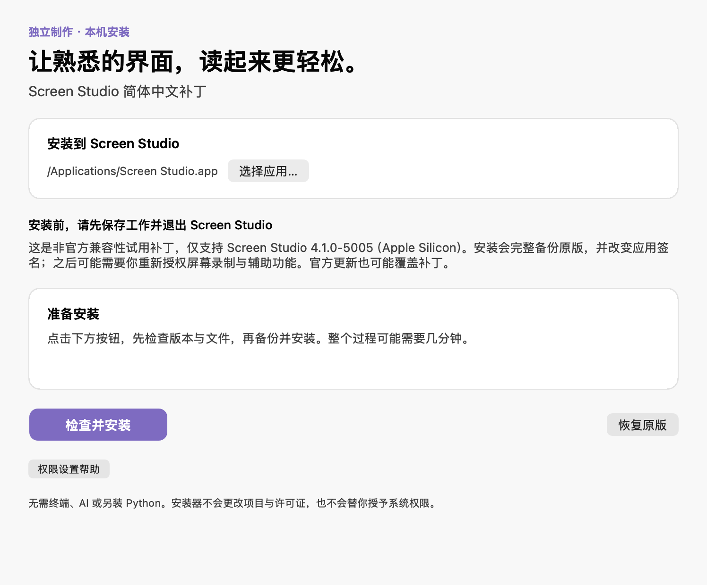

# Screen Studio 简体中文补丁

为 **Screen Studio 4.1.0-5005 · Apple Silicon** 提供本地中文界面。独立、非官方、限定版本的兼容性试用补丁，含 2,068 条翻译，提供双击安装器和 AI Agent 安装包。

**这是补丁，不是 Screen Studio 软件、激活工具或官方语言包。** 你需要自行安装指纹匹配、官方签名完整的 Screen Studio。其他版本、Intel 构建和被修改的应用会被拒绝。不能保证所有正版客户环境兼容。

## 下载与安装（推荐）

**[⬇ 下载双击安装包 · 约 4.1 MB](https://github.com/maozepeng6-jpg/screen-studio-zh-cn/releases/download/desktop-v1.0.0/ScreenStudio-%E4%B8%AD%E6%96%87%E4%B8%80%E9%94%AE%E5%AE%89%E8%A3%85%E5%8C%85.zip)**　[查看发布页](https://github.com/maozepeng6-jpg/screen-studio-zh-cn/releases/tag/desktop-v1.0.0)

不需要 AI、终端或另装 Python。安装器自动检查、完整备份、安装并校验。

1. 下载并解压 `ScreenStudio-中文一键安装包.zip`，双击里面的 **Screen Studio 中文安装器.app**。
2. 保存当前录制/剪辑工作并退出 Screen Studio，点击 **检查并安装**。默认自动找到“应用程序”里的软件；找不到时点“选择应用…”自行选择。
3. 如果 macOS 弹出管理员验证，由你本人输入电脑密码或使用 Touch ID。完成后点 **打开 Screen Studio**。
4. 若软件要求录屏或辅助功能权限，点安装器里的 **权限设置帮助**，按系统提示授权。最后录几秒并导出，确认能正常使用。

下载页里的 **Source code (zip)** 是源码，普通用户请选择 **ScreenStudio-中文一键安装包.zip**。压缩包也附有 `先看这里.txt`。



### 先确认你的版本

| 项目 | 双击安装版要求 |
| --- | --- |
| 电脑 | M 系列芯片的 Mac（Apple Silicon） |
| 系统 | macOS 13 或更新版本 |
| Screen Studio | **4.1.0-5005**，官方签名及资源指纹必须匹配；可先在软件的“关于 Screen Studio”中查看版本 |
| 空间 | 预留数 GB，供完整备份和临时副本使用；空间不足会停止 |

其他版本、Intel 构建或已经改动的应用会停止安装。汉化会改变应用签名，可能需要重新授权；官方更新也可能覆盖补丁。补丁不含软件本体或许可证，不代替正版购买。

### 第一次打不开怎么办？

当前安装器尚无 **Apple Developer ID 签名和公证**。如果 macOS 提示无法验证开发者，确认下载来源后，可到 **系统设置 → 隐私与安全性** 查看是否提供“仍要打开”，由你本人决定是否允许。[Apple 官方说明](https://support.apple.com/zh-cn/102445)

如果系统明确报告恶意软件、文件损坏或企业策略阻止，请停止并保留提示，不关闭系统保护。安装器不会收集电脑密码，也不会自动批准录屏等隐私权限。

### 想取消汉化怎么办？

保存工作并退出 Screen Studio，重新打开中文安装器，点击 **恢复原版**。安装器会核验本次备份后恢复；请保留安装器及备份，不要移动或重命名。软件若已更新或文件发生变化，恢复会停止，避免用旧版本覆盖。

本次双击版的打包校验、80 项辅助/模拟测试和独立运行检查已通过；**尚未完成独立客户 Mac 的完整安装、权限和真实录屏验收**。详见 [桌面版验证记录](desktop/VALIDATION.md)。

## 另一种方式：交给 AI 安装

从 [Releases](https://github.com/maozepeng6-jpg/screen-studio-zh-cn/releases/tag/v1.1.1) 下载 `ScreenStudio-ZH-4.1.0-5005-AI.zip`，解压后把整个文件夹交给 **Codex、Claude Code 等可以操作本机文件和终端的 Agent**。仅能聊天的网页 AI 不能直接安装。

复制这段话给你的 AI：

> 请先读取这个补丁文件夹里的 AGENTS.md、先读我.md 和 manifest.json。对我 Mac 上的 Screen Studio 执行只读兼容检查，解释签名与权限影响后，按文档安装并保留备份和 state.json。分别验证中文界面、实际短录屏、预览与导出，未测试的项目如实标注。不要绕过版本检查、激活或系统安全策略，不要自动重置系统权限。遇到不兼容就停止并说明恢复方法。

## AI / 命令行版安装条件

| 项目 | 条件 |
| --- | --- |
| 系统和应用 | macOS；官方签名完整的 Screen Studio **4.1.0-5005 arm64**；精确资源指纹匹配 |
| 工具 | Python 3.9+ 和 macOS 的 `codesign`、`ditto`、`lipo`；安装不需要 Node/npm/AI API |
| 状态和磁盘 | 保存工作并退出应用；预留数 GB 用于完整备份、构建及回滚，以 preflight 检查为准 |
| 签名 | 修改资源后改用本机 ad-hoc 签名，无法保留有效的原开发者签名或公证 |
| 系统权限 | 可能需要重新授权；Touch ID/密码由用户本人在系统界面完成 |

安装器不访问账号、密码、项目或许可证，不下载软件、不上传资料。你使用的 AI 服务自身如何处理会话与文件，应以其规则为准。

## 手动命令

在解压后的补丁目录执行；仓库用户先进入 `package/ScreenStudio-ZH-4.1.0-5005`。

```sh
python3 installer.py preflight --app "/Applications/Screen Studio.app"
# 检查通过，并理解签名变化后：
python3 installer.py install --app "/Applications/Screen Studio.app" --accept-signature-change
```

安装后保存 JSON 输出中的 `state` 路径，代入下列命令：

```sh
python3 installer.py verify --state "/实际备份目录/state.json"
python3 installer.py restore --state "/实际备份目录/state.json"
```

应用不在默认目录时，验证和恢复也要追加安装时同一个 `--app`。**保留相应版本的安装器、备份与回执，不要随意移动备份目录。** 旧 1.0.0 / 1.1.0 补丁请先用原安装包和原回执恢复，再安装此版本；不在旧补丁上叠加。

## 已允许权限，为什么还卡住？

系统的旧授权可能绑定原签名。汉化重签后，开关显示已开启不代表新副本已获授权。

先按 [权限诊断和恢复说明](package/ScreenStudio-ZH-4.1.0-5005/先读我.md#已开启权限却仍卡住时) 排查。包内 `repair_permissions.py --check` 只检查应用身份、签名和运行情况，不查询实际 TCC 授权；可选修复只撤销已明确选择的本应用权限，随后仍须用户通过 macOS 重新授权。不能关闭系统保护或伪造授权结果。

## 验证到什么程度？

- 本次自动化验收与历史实机记录分开列在 [验证记录](package/ScreenStudio-ZH-4.1.0-5005/验证记录.md)。模拟测试不代表其他用户设备实测。
- 历史开发机已查看中文界面，完成已有视频的导入/预览/导出，以及另一次实际屏幕录制/停止/预览；后一次录屏的导出、声音与摄像头录制未完成测试。
- **尚未完成独立正版付费客户的完整激活、云分享、在线功能、更新兼容性测试。** 不承诺全版本兼容、百分之百无遗漏或永远可用。
- 官方更新可能覆盖补丁或改变结构。新版本需单独适配，不要强行套用或关闭安全更新。

## 开发与测试

测试使用合成应用、模拟系统命令及最小 DOM，不需要 Screen Studio 本体或原始源码，也不会安装补丁或重置权限。需要 Python 3.9+ 和 Node 18+：

```sh
python3 -m unittest discover -s package-tests -v
python3 -m unittest discover -s tests -p 'test_*.py' -v
node --test tests/localize.test.cjs
python3 scripts/build_release.py
```

生成的安装包位于 `dist/`。双击版构建与测试见 [桌面安装器说明](desktop/README.md)。分发包不含 Screen Studio 软件本体、录屏、客户备份或安装回执。SHA-256 用于检查意外损坏，不是作者签名，也不能单独证明来源可信。

## 许可和反馈

本仓库原创补丁代码、原创中文翻译与文档以 [MIT License](LICENSE) 发布。Screen Studio 商标、软件及来源于其界面的原始文案权利归各自权利人；MIT 不授予 Screen Studio 软件本身的使用、修改或再分发许可。本项目未获官方认可或商业汉化许可。历史商业使用核对见 [销售前必读](package/ScreenStudio-ZH-4.1.0-5005/销售前必读.md)，这不是收费承诺或法律结论。

反馈可提交 Issue：附上应用版本、macOS 版本、脱敏错误代码和必要的界面截图。不要上传 app、ASAR、完整备份、项目、许可证、密码或含个人信息的回执。
